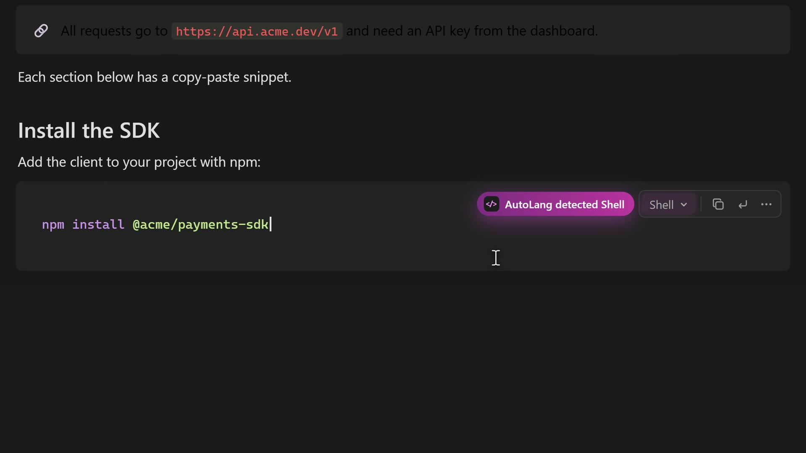

# Notion AutoLang

Sets the language of Notion code blocks automatically while you write.

[](frontend/src/assets/demo/autolang-demo.mp4)

▶ [Watch the demo](frontend/src/assets/demo/autolang-demo.mp4) (55 s, Notion dark mode). A light-mode version plays on the website.

The repo is an npm workspace with three parts:

| Folder | What it is |
|---|---|
| `backend/` | Express API: Notion sign-in (OAuth), language detection, `POST /pages/:pageId/sync`, which sets the language of new and edited code blocks, and the public `POST /detect` behind the website's playground |
| `extension/` | Chrome extension: watches Notion pages and asks the backend to sync when you pause typing |
| `frontend/` | The website (React + Vite), deployed on Vercel |

## Run it locally

You need Node.js 22 or newer, Chrome, and a Notion account.

### 1. Install

From the repo root:

```bash
npm install
```

This installs all three parts.

### 2. Create your own Notion integration

Each developer uses their own integration, so you never need anyone else's secrets.

1. Go to <https://www.notion.so/profile/integrations> and click **New integration**.
2. Choose a **Public** integration (Public is what enables OAuth sign-in).
3. Under capabilities, allow **Read content** and **Update content**.
4. Add this **redirect URI**: `http://localhost:3000/auth/notion/callback`
5. Copy the **OAuth client ID** and **OAuth client secret**.

### 3. Configure the backend

```bash
cp backend/.env.example backend/.env
```

Fill in `backend/.env`:

- `NOTION_CLIENT_ID` and `NOTION_CLIENT_SECRET`: from step 2.
- `SESSION_SECRET`: any long random string, for example the output of
  `node -e "console.log(require('crypto').randomBytes(32).toString('hex'))"`.
- Leave the rest as they are. `NOTION_API_KEY` and `NOTION_PAGE_ID` are only for the dev scripts.

`backend/.env` is ignored by git. Never commit it.

### 4. Start the backend

```bash
npm start --prefix backend
```

It runs on <http://localhost:3000>. Check <http://localhost:3000/health>.

### 5. Load the extension

1. Open `chrome://extensions` and turn on **Developer mode**.
2. Click **Load unpacked** and choose the `extension/` folder.
3. Pin it from Chrome's puzzle-piece menu so its icon stays visible.

### 6. Connect your Notion workspace

Click the AutoLang icon, then **Connect Notion**. Choose the pages AutoLang may use and approve. The popup and the icon's badge show whether you're connected; a `!` on the icon means something needs you.

The backend keeps sessions in memory for now, so **connect again after every backend restart**. The popup will show **Not connected**.

### 7. Try it

On a Notion page you shared in step 6, add a code block and type some code. About 2 seconds after you stop, its language changes.

To see what the extension is doing, click **service worker** on its card in `chrome://extensions`. Changes and errors are logged as `[AutoLang] …`.

More detail: [extension/README.md](extension/README.md).

### The website (optional)

```bash
npm run dev --prefix frontend
```

It runs on <http://localhost:5173>. Its **Try again** link (shown after a failed Notion sign-in) uses the local backend unless `VITE_API_URL` is set. Signing in itself happens from the extension. It has a FAQ page at `/faq`; `frontend/vercel.json` sends every path to the app so `/faq` also works when deployed. The demo video in its "See how it works!" section is rendered from `demo-video/` (see its README).

## Tests

Each part has its own tests, written before the code:

```bash
npm test --prefix backend
npm test --prefix extension
npm test --prefix frontend
```

What each test checks: [backend/tests.md](backend/tests.md).

## Known limitations

- **Restarting the backend signs you out** and forgets which code blocks it has already seen.
- **The confidence threshold** (`CONFIDENCE_THRESHOLD`, default 0.4) hasn't been tuned. Short snippets can be skipped.
- **Local only.** The extension talks to `http://localhost:3000` (`extension/src/config.js`).
